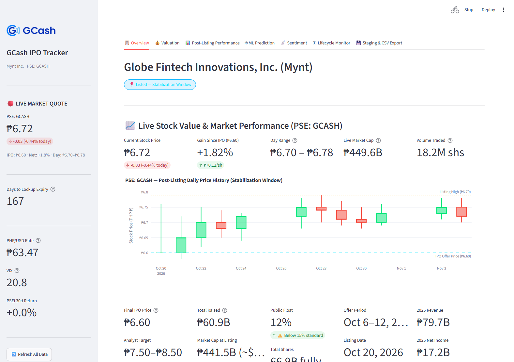

# GCash IPO Tracking & Post-Listing Analytics Pipeline

[](https://streamlit.io/)
[](https://python.org/)
[](https://xgboost.readthedocs.io/)
[](https://sqlite.org/)
[](LICENSE)

A high-performance quantitative research, valuation, and post-listing tracking pipeline for **GCash (Globe Fintech Innovations, Inc. / Mynt)** on the Philippine Stock Exchange under the ticker [**`PSE: GCASH`**](https://edge.pse.com.ph).

---

## 📸 Dashboard Snapshot



*Interactive 7-tab Streamlit dashboard running live at `http://localhost:8501`.*

---

## 📌 Executive Summary & Current Market Status

GCash (operated by Mynt) is the Philippines' dominant fintech superapp with over **94 million registered users** and ubiquity across payments, micro-lending, remittances, savings, and investments. Its market debut marks the **largest IPO in Philippine capital markets history**.

Following its official listing on **October 20, 2026**, the pipeline transitioned from pre-IPO modeling into **active post-listing tracking** during the Greenshoe price stabilization window.

| Parameter | Actual Market Detail |
|---|---|
| **Issuer** | Globe Fintech Innovations, Inc. (Mynt) |
| **PSE Ticker** | [**`GCASH`**](https://edge.pse.com.ph) |
| **Trading Status** | **Listed — Price Stabilization Window (D+15)** |
| **Final IPO Offer Price** | **₱6.60** per share *(priced at 34% discount vs. ₱10.00 ceiling)* |
| **Current Stock Price** | **₱6.72** *(+1.82% / +₱0.12 vs. IPO price)* |
| **Total Capital Raised** | **₱60.92 Billion** *(including overallotment facility)* |
| **Total Diluted Shares** | **66.90 Billion** shares |
| **Market Cap at Listing** | **₱441.54 Billion** (~US$7.61 Billion at ₱58/\$) |
| **Live Market Cap** | **₱449.57 Billion** (~US$7.75 Billion) |
| **Public Float** | **12.0%** *(8.03B shares; SEC exemption granted)* |
| **Listing Date** | **October 20, 2026 (D+0)** |
| **Greenshoe Expiry** | **November 19, 2026 (D+30)** *(1.20B share stabilization window)* |
| **Lockup Expiry** | **April 20, 2027 (D+180)** *(58.87B locked shares / 7.3× overhang)* |
| **Major Shareholders** | Globe Telecom (~45%), Ant Group (~33%), Ayala Corp (~10%), MUFG (~5%) |

---

## 🔬 Core Analytical Capabilities

### 1. Post-Listing Performance & Return Attribution (`src/analytics/post_listing.py`)
Tracks live daily price action since the October 20, 2026 debut and deconstructs secondary market dynamics:
- **Return Attribution Engine:** Decomposes stock returns from ₱6.60 into **Market Beta (PSEi: +0.83%)** vs. **GCASH Alpha (+0.99%)**.
- **12-Month Forward Price Targets:** Four forward-looking models calibrated to post-listing multiples:
  - *Forward P/E (FY2026E Net Income: ₱20.6B @ 22–30×):* **₱8.02** (+19.4% upside)
  - *EV/Revenue (FY2026E Revenue: ₱99.0B @ 4–7×):* **₱8.14** (+21.1% upside)
  - *EV/EBITDA (FY2026E EBITDA: ₱29.7B @ 12–18×):* **₱6.65** (-1.0%)
  - *PSE Sector Comps (GLO, Converge, Monde @ 18–27×):* **₱6.79** (+1.0%)
  - **Consensus Midpoint Target:** **₱7.40** (+10.1% upside vs. current ₱6.72)
- **Greenshoe Stabilization Monitor:** Real-time countdown tracking underwriter price support defending the ₱6.60 floor through November 19, 2026.
- **Liquidity & Volume Decay:** Monitors secondary market volume decay from listing day (78.5M shares $\rightarrow$ 18.2M shares, -76.8% decay).
- **Shareholder Lockup Schedule:** Granular tracking of 58.87B shares unlocking on April 20, 2027 across Globe, Ant Group, Ayala, and MUFG.

### 2. 5-Method Fair Value Triangulation (`src/analytics/valuation.py`)
Computes intrinsic and relative value across 5 independent valuation models benchmarked against live prices:
1. **EV / Revenue Multiple:** Calibrated against global & regional peers (Block, PayPal, Sea Ltd, Grab, Nubank) with emerging-market discount.
2. **Gross Profit Multiple:** Growth-adjusted multiple based on fintech Rule-of-40 benchmarks.
3. **P/E Multiple:** Applied to NTM net income projections (2025 net income: ₱17.2B at 21.6% net margin).
4. **5-Year Discounted Cash Flow (DCF):** Bear (13% WACC), Base (11% WACC), and Bull (9% WACC) scenarios with terminal growth.
5. **PSE Precedent IPO Multiples:** Benchmarked against Philippine mega-listings (*Monde Nissin, Converge ICT, Citicore Energy REIT*).

### 3. Machine Learning Retrospective & Sensitivity (`src/analytics/classifier.py`)
- **Dual-Headed XGBoost Model:** Day-1 pop classification ($>+10\%$) and continuous expected return regression.
- **Calibrated Post-Pricing Features:** Uses actual pricing data:
  - **-34% Price Range Revision:** (₱6.60 final vs. ₱10.00 ceiling), which acts as the dominant suppressive signal explaining the flat Day-1 close.
  - **Actual Listing P/E:** 24.6× on ₱441.5B market cap.
  - **Actual Listing EV/Rev:** 4.91× on ₱90B NTM revenue.
- **Interactive Stress-Testing:** Real-time sensitivity sliders to simulate market shocks (e.g., Bear market: PSEi $-10\%$, VIX $30$; Bull market: PSEi $+5\%$, VIX $15$).

### 4. Automated Risk Flag Detection (10 Key Triggers, `src/analytics/risk_flags.py`)
Multi-factor risk evaluation categorizing exposures into **🚨 Critical**, **⚠️ Warning**, **ℹ️ Info**, and **✅ Clear**:
- **🚨 80% Secondary Shares:** Only 20% of the raise represented primary capital for Mynt; ~₱48.7B went directly to selling shareholders.
- **🚨 7.3× Lockup Overhang Ratio:** On April 20, 2027, 58.87B shares unlock against an 8.03B float.
- **⚠️ Public Float at 12%:** SEC granted exemption below standard 15%, contributing to post-listing liquidity dry-up.
- **⚠️ Decelerating Revenue Growth:** YoY revenue growth tempered from $+45\%$ (2025) to $+10\%$ (H1 2026).
- **✅ High Profitability:** Profitable unicorn (₱17.2B net income in 2025; 21.6% margin).

### 5. Multi-Source Sentiment Monitoring (`src/ingestion/sentiment.py`)
- **Social Sentiment:** Scrapes Philippine investing communities (`r/phinvest`, `r/PHStockMarket`) via Reddit PRAW.
- **Financial News:** Scrapes RSS feeds from BusinessWorld, Philippine Star, Inquirer, and Manila Bulletin.
- **VADER Sentiment Engine:** Generates compound sentiment scores (-1.0 to +1.0) with automated fallback to cached SQLite staging records.
- **Google Trends:** Monitors search interest velocity in the Philippines.

### 6. SQLite Staging Layer & Incremental CDC Engine (`src/storage/database.py`)
- **Full Extract & Incremental Delta Loading:** Source extraction with deterministic MD5 content fingerprinting (`record_hash`). Unchanged duplicate records are skipped.
- **Audit Logging & Watermarks:** Logs every pipeline execution to `etl_load_audit` and records timestamps in `etl_watermarks`.
- **Automated CSV Exporter:** One-click export of all tables and views directly into `data/exports/`.

---

## 🏛️ System Architecture

```
gcash-ipo-tracking/
│
├── assets/
│   ├── gcash_logo.png             # Bundled high-res GCash brand logo
│   ├── gcash_logo.svg             # Vector brand asset
│   └── dashboard_snapshot.png     # Full dashboard screenshot
│
├── data/
│   ├── gcash_staging.db           # SQLite WAL staging database
│   ├── exports/                   # Automated CSV export destination
│   └── training/                  # Historical PSE IPO training dataset
│
├── models/
│   ├── ipo_classifier.pkl         # Trained XGBoost classifier & regressor
│   └── scaler.pkl                 # StandardScaler feature preprocessor
│
├── src/
│   ├── ingestion/
│   │   ├── pse_edge_scraper.py    # PSE EDGE disclosure scraper & prospectus facts
│   │   ├── market_data.py         # GCash live quote, peer multiples & macro data
│   │   ├── fx_rates.py            # BSP Open Data API + yfinance fallback
│   │   └── sentiment.py           # Reddit PRAW + News RSS + Google Trends
│   ├── analytics/
│   │   ├── post_listing.py        # Alpha/beta attribution, 12M targets, greenshoe & lockup
│   │   ├── valuation.py           # 5-method valuation triangulation engine
│   │   ├── classifier.py          # XGBoost prediction pipeline & sensitivity analysis
│   │   ├── lifecycle.py           # Lifecycle tracker & event roadmap
│   │   └── risk_flags.py          # Automated 10-point risk flag evaluation
│   ├── storage/
│   │   └── database.py            # SQLite staging layer, incremental CDC & CSV exporter
│   ├── monitoring/
│   │   └── alerts.py              # Automated 4-hour PSE EDGE watcher & Discord webhooks
│   └── dashboard/
│       └── app.py                 # Streamlit 7-tab dashboard application
│
├── run_dashboard.py               # Robust dashboard bootstrap runner
├── requirements.txt               # Locked production dependencies
├── .env.example                   # API credentials template
├── .gitignore                     # Git exclusion rules
└── README.md                      # Project documentation
```

---

## ⚡ Quick Start

### 1. Clone & Setup Environment
```bash
git clone https://github.com/glouize/gcash-ipo-tracking.git
cd gcash-ipo-tracking

# Create and activate virtual environment
python -m venv venv
venv\Scripts\activate      # Windows PowerShell / CMD
source venv/bin/activate   # Linux / macOS

# Install dependencies
pip install -r requirements.txt
```

### 2. Environment Configuration (Optional)
```bash
cp .env.example .env
```
Optional credentials for live social streams and alerts:
- `REDDIT_CLIENT_ID` / `REDDIT_CLIENT_SECRET`: Free from [reddit.com/prefs/apps](https://www.reddit.com/prefs/apps)
- `DISCORD_WEBHOOK_URL`: Discord webhook for automated disclosure alerts

### 3. Launch Dashboard
```bash
# Recommended runner:
python run_dashboard.py

# Or via streamlit CLI:
streamlit run src/dashboard/app.py
```
Open **[http://localhost:8501](http://localhost:8501)** in your browser.

---

## 🖥️ Dashboard Navigation (7 Tabs)

| Tab | Icon | Key Features |
|---|:---:|---|
| **Overview** | 📋 | Live stock performance banner (`PSE: GCASH`), ₱6.60 IPO benchmark, 15-day price history, financials, cap table, and risk flags |
| **Valuation** | 💰 | 5-method fair value table, target dispersion chart with live stock price overlay (₱6.72), and peer comparables table |
| **Post-Listing Performance** | 📊 | Return attribution (Market Beta vs. Alpha), daily candlestick + volume decay charts, indexed comparison vs. PSEi, 12M forward price targets, greenshoe status, and lockup schedule |
| **ML Prediction** | 🤖 | Retrospective XGBoost analysis with actual -34% price revision, feature importances, and multi-scenario stress-testing |
| **Sentiment** | 📡 | Google Trends search velocity, daily VADER sentiment bar chart, macro context indicators (VIX, PSEi, PHP/USD), and SQLite fallback |
| **Lifecycle Monitor** | 🗓 | Days Since Listing (`D+15`), Greenshoe expiry countdown, comprehensive event roadmap, and lockup overhang monitor |
| **Staging & CSV Export** | 💾 | SQLite database status card, **⚡ Run Incremental Pipeline** CDC trigger, audit log inspection, and bulk disk export to `data/exports/` |

---

## 💾 Staging Database Schema & Views

### Staging Tables (`data/gcash_staging.db`)
- `stg_valuation_history`: Time-series fair value estimates across all 5 models.
- `stg_peer_comps`: Daily financial multiples of fintech peers (Block, PayPal, Sea Ltd, Grab, Nubank).
- `stg_macro_snapshot`: Daily closing VIX, trailing 30-day PSEi return, and BSP PHP/USD exchange rate.
- `stg_sentiment_daily`: Aggregated social and news polarity scores.
- `stg_predictions`: Historical record of ML predictions and input assumptions.
- `stg_pse_disclosures`: Formal company disclosures filed on PSE EDGE.
- `etl_load_audit`: Execution logs (`records_read`, `records_inserted`, `records_skipped`, status).
- `etl_watermarks`: High-water marks for each data domain.

### Pre-built Analytical Views
- `v_valuation_trend`: Fair value evolution over time.
- `v_macro_trend`: Macro volatility and FX movement history.
- `v_sentiment_trend`: Moving average sentiment leading through listing.
- `v_prediction_trend`: Trajectory of ML probability forecasts.
- `v_latest_valuation`: Active consensus estimates from the latest execution.

---

## 🔔 Background Automation (PSE EDGE Watcher)

Run the standalone monitoring daemon to poll PSE EDGE every 4 hours for official disclosures and trigger Discord notifications:
```bash
python src/monitoring/alerts.py
```

---

## 📜 Disclaimer
*This repository is created solely for quantitative research, financial modeling, and software engineering demonstration purposes. Nothing contained herein constitutes investment, financial, legal, or tax advice. Market projections and machine learning estimates are probabilistic simulations based on publicly available information and synthetic historical benchmarks.*
